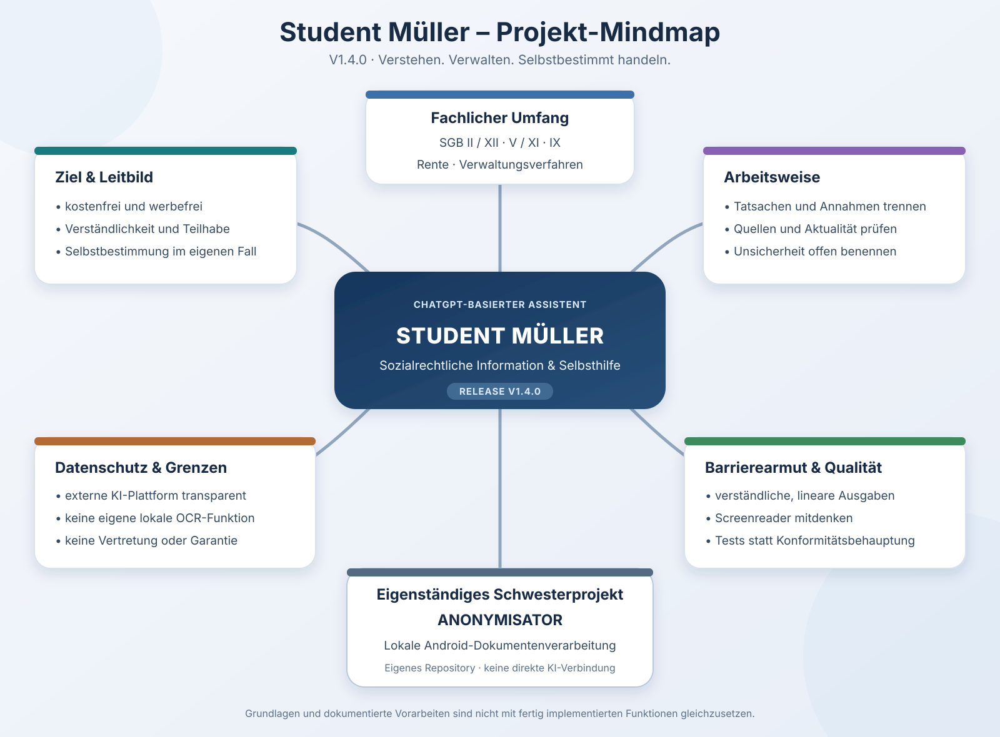

# Student Müller

**Verstehen. Verwalten. Selbstbestimmt handeln.**

Student Müller ist ein kostenfreies, werbefreies, KI-gestütztes Informations- und Selbsthilfeprojekt. Es unterstützt Menschen dabei, sozialrechtliche Sachverhalte und Verwaltungsentscheidungen zu verstehen und die eigenen persönlichen Angelegenheiten selbstbestimmt zu bearbeiten.

> Student Müller ist keine Rechtsanwaltskanzlei, übernimmt keine Vertretung und erteilt keine verbindliche Rechtsauskunft. KI-Ausgaben können fehlerhaft oder veraltet sein. Prüfe Tatsachen, Rechtsgrundlagen und Fristen anhand aktueller, verlässlicher Quellen.

## Ausprobieren
Öffne [ChatGPT](https://chatgpt.com/) und übernimm die vollständige [Systemanweisung](SYSTEMANWEISUNG.md) in einen neuen Chat. Externe KI-Dienste unterliegen ihren jeweiligen Nutzungs- und Datenschutzbedingungen. Teile keine unredigierten Bescheide, Gutachten, Gesundheitsdaten, Aktenzeichen oder andere vertrauliche Angaben.

## Beispiel zum Testen
Der vollständig fiktive [Beispielfall Küchen-Erstausstattung](docs/BEISPIELFALL_KUECHENERSTAUSSTATTUNG.md) enthält Antrag, Vermieterbestätigung, Ablehnungsbescheid, Testanfragen und eine Vergleichsvorlage. Für diesen Test sind keine echten Dokumente erforderlich.

## Projektgrenze: Anonymisator
Die lokale Android-Dokumentenverarbeitung ist ein eigenständiges Projekt: **[Anonymisator – separates Repository](https://github.com/samysmurf/Anonymisator)**. Student Müller enthält keine eigene OCR-, PDF-Schwärzungs- oder Anonymisierungs-Engine und setzt deren Verfügbarkeit nicht voraus. Es findet keine automatische Datenübertragung zwischen den Projekten statt.

## Fachlicher Umfang
- SGB II und SGB XII
- Kranken- und Pflegeversicherung
- Rehabilitation, Teilhabe und Schwerbehindertenrecht
- Erwerbsminderung und Rentenrecht
- Verwaltungsverfahren, Bescheidverständnis und Rechtsbehelfe
- Strukturierte Entwürfe für eigene Schreiben

## Status
| Bereich | Stand |
|---|---|
| ChatGPT-basierter fachlicher Prototyp | Grundlagen vorhanden; laufende Weiterentwicklung |
| Quellen- und Dokumentenworkflow | konzipiert; Funktionstests fortführen |
| Barrierefreiheit | Entwicklungsziel; keine Konformitätsprüfung behauptet |
| Lokale OCR / Anonymisierung | separates Projekt Anonymisator; nicht Bestandteil von Student Müller |

Geplante Funktionen werden nicht als implementiert dargestellt. Details: [Funktionsstatus](docs/FUNKTIONSSTATUS.md) und [Roadmap](ROADMAP.md).

## Persönliche Nutzung und Grenzen
Die offizielle Assistentenfassung ist für die eigenen persönlichen Angelegenheiten der anfragenden Person bestimmt. Sie ist nicht dafür vorgesehen, individuelle fremde Angelegenheiten im Auftrag oder Namen anderer Personen rechtlich zu prüfen oder zu bearbeiten. Allgemeine, nicht auf einen fremden Einzelfall bezogene Informationen und synthetische Demonstrationen bleiben möglich. Diese Zweckbestimmung ersetzt keine eigenständige RDG-Prüfung.

Nutzer bleiben für Eingaben, Entscheidungen und Verwendung der Ergebnisse verantwortlich. Haftung richtet sich nach geltendem Recht; zwingende gesetzliche Haftung bleibt unberührt. Ein pauschaler Ausschluss sämtlicher Ansprüche wird nicht erklärt.

## Lizenzen
- Eigener Programmcode: Apache License 2.0.
- Originäre Projekttexte und Dokumentation: CC BY-SA 4.0.
- Drittanbieterinhalte, Bibliotheken, Daten und Marken bleiben ihren jeweiligen Bedingungen unterworfen.

Die bestehenden Lizenzdateien bleiben maßgeblich und werden durch diese Projektbeschreibung nicht geändert.

## Dokumentation
- [Systemanweisung](SYSTEMANWEISUNG.md)
- [Mindmap als Markdown](mindmap/MINDMAP_V1.4.md)
- [Roadmap](ROADMAP.md) · [Changelog](CHANGELOG.md)
- [Architektur](docs/ARCHITEKTUR.md) · [Datenschutz](docs/DATENSCHUTZ.md)
- [Funktionsstatus](docs/FUNKTIONSSTATUS.md) · [Barrierefreiheit](docs/BARRIEREFREIHEIT.md)
- [Beispielfall Küchen-Erstausstattung](docs/BEISPIELFALL_KUECHENERSTAUSSTATTUNG.md)
