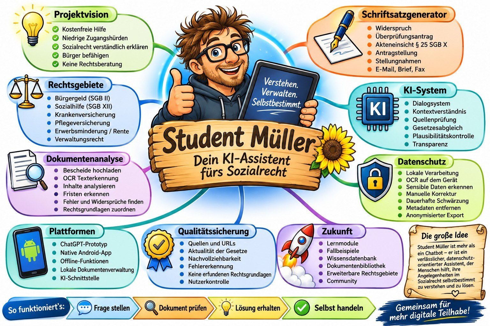

# Student Müller

**Verstehen. Verwalten. Selbstbestimmt handeln.**

Grafische Projektübersicht; sie zeigt sowohl vorhandene Grundlagen als auch ausdrücklich geplante Funktionen.

## Student Müller jetzt selbst ausprobieren

**Sie möchten bereits jetzt mit eigenen Anliegen testen, wie Student Müller funktioniert?**

Hier können Sie [ChatGPT direkt öffnen](https://chatgpt.com/) und die [Systemanweisung von Student Müller](SYSTEMANWEISUNG.md) in einen neuen Chat übernehmen. Öffnen Sie dazu die Systemanweisung, kopieren Sie den vollständigen Inhalt und fügen Sie ihn zu Beginn des neuen Chats ein. So erhält ChatGPT die fachlichen Leitlinien und Arbeitsregeln dieses Projekts.

> **Wichtiger Datenschutzhinweis:** Bitte teilen Sie keine persönlichen oder vertraulichen Daten direkt mit ChatGPT. Anonymisieren Sie Dokumente und Sachverhalte vor der Übermittlung eigenständig und sorgfältig. Die geplante lokale Anonymisierung in der Android-App ist noch nicht vollständig umgesetzt. Geben Sie insbesondere keine Namen, Anschriften, Geburtsdaten, Aktenzeichen, Kontodaten oder andere Angaben weiter, durch die Personen identifizierbar werden könnten.

Vielen Dank, dass Sie Student Müller ausprobieren und zur Weiterentwicklung beitragen!

Student Müller ist ein kostenfreies, niedrigschwelliges, KI-gestütztes Assistenzprojekt. Es soll Menschen dabei unterstützen, sozialrechtliche Sachverhalte zu verstehen, Verwaltungsentscheidungen einzuordnen und eigene Verwaltungsangelegenheiten selbstbestimmt zu bearbeiten.

> Student Müller ist ein Informations- und Assistenzprojekt, keine Rechtsanwaltskanzlei. Es ersetzt weder individuelle anwaltliche Beratung noch Entscheidungen zuständiger Behörden oder Gerichte.

## Projektstatus

| Bereich | Status |
|---|---|
| Fachlicher ChatGPT-Prototyp | Grundlagen und Funktionen vorhanden; laufende Weiterentwicklung |
| Android Local Agent | In Bearbeitung |
| Termux / Python / Android-Shell | Auf dem Entwicklungsgerät eingerichtet bzw. teilweise erprobt |
| OCR mit Tesseract | Tesseract 5.5.4 installiert; deu/eng vorhanden; erster lokaler OCR-Test erfolgreich |
| Sichere Dokumentenanonymisierung | Geplant |
| Native Android-App | Geplant |
| Offline-KI | Untersuchung / Evaluierung, nicht als verfügbar behauptet |

Der technische Arbeitsstand wird in [docs/FUNKTIONSSTATUS.md](docs/FUNKTIONSSTATUS.md) dokumentiert. Geplante Funktionen werden nicht als implementiert dargestellt.

## Technischer Ansatz: direkt auf Android

Die Android-Vorarbeiten erfolgen unmittelbar auf einem realen Android-Gerät und nicht nur in einer PC-Simulation. Als mobile Entwicklungsumgebung wird Termux eingesetzt. Ergänzend wurden Python, Wireless Debugging, Shizuku und `rish` eingerichtet bzw. erprobt. Damit werden Android-Systemgrenzen, Paketinformationen, Shell-Zugriffe und Berechtigungen direkt am Gerät untersucht.

Tesseract 5.5.4 wurde am 01.11.2026 über Termux installiert. Am 02.11. waren die Sprachdaten `deu` und `eng` vorhanden; ein lokaler OCR-Test auf einem Bild aus dem AndroidLocalAgent-Testverzeichnis lief erfolgreich. Die Erkennungsqualität wird weiter verbessert; PDF-Pipeline und Python-Anbindung sind noch offen. Details und Terminalausgaben: [docs/OCR_TESSERACT_TERMUX.md](docs/OCR_TESSERACT_TERMUX.md).

## Datenschutz-Leitlinie

Die Zielarchitektur sieht vor, Dokumente zunächst lokal auf dem Android-Gerät zu verarbeiten. OCR, Datenerkennung, Vorschau, manuelle Korrektur, echte dauerhafte Schwärzung, Metadatenbereinigung und Export sollen vor einer möglichen externen KI-Übermittlung stattfinden. Eine Übermittlung darf erst nach einer verständlichen Vorschau und ausdrücklichen Nutzerfreigabe erfolgen.

Diese Datenschutzfunktionen sind Zielvorgaben und noch nicht als fertige App-Funktionen verfügbar.

## Projektstruktur

- [SYSTEMANWEISUNG.md](SYSTEMANWEISUNG.md) – konsolidierte Arbeits- und Systemanweisung
- [mindmap/MINDMAP_V1.3.md](mindmap/MINDMAP_V1.3.md) – Projekt-Mindmap mit Statuskennzeichnung
- [ROADMAP.md](ROADMAP.md) – Entwicklungsphasen und nächste Schritte
- [CHANGELOG.md](CHANGELOG.md) – nachvollziehbare Änderungen
- [CONTRIBUTING.md](CONTRIBUTING.md) – Regeln für Beiträge
- [SECURITY.md](SECURITY.md) – Hinweise zu Sicherheitsmeldungen
- [docs/ARCHITEKTUR.md](docs/ARCHITEKTUR.md) – technische Zielarchitektur
- [docs/DATENSCHUTZ.md](docs/DATENSCHUTZ.md) – Datenschutzprinzipien und geplante Kontrollen
- [docs/FUNKTIONSSTATUS.md](docs/FUNKTIONSSTATUS.md) – Statusübersicht
- [docs/TECHNISCHE_VORARBEITEN_TERMUX.md](docs/TECHNISCHE_VORARBEITEN_TERMUX.md) – geräte- und systemnahe Arbeiten
- [docs/OCR_TESSERACT_TERMUX.md](docs/OCR_TESSERACT_TERMUX.md) – OCR/Tesseract-Evaluierung

## Lizenzen

Das Projekt verwendet bewusst zwei getrennte Lizenzmodelle:

- **Eigener Programmcode:** Apache License 2.0 – siehe [LICENSE-CODE](LICENSE-CODE).
- **Projekttexte und Dokumentation:** Creative Commons Attribution-ShareAlike 4.0 International (CC BY-SA 4.0) – siehe [LICENSE-DOCS.md](LICENSE-DOCS.md).

Die Zuordnung und ihre Grenzen sind in [LICENSE](LICENSE) erklärt. Fremde Bibliotheken, OCR-Sprachdaten, Marken, externe Texte und sonstige Drittinhalte bleiben ihren jeweiligen Rechten und Lizenzbedingungen unterworfen. Die Projektlizenz überträgt keine Rechte, die die Beitragenden nicht selbst besitzen oder lizenzieren dürfen.

## Mitwirkung

Beiträge, technische Prüfungen, Dokumentation, Tests und fachliche Reviews sind willkommen. Vor einer öffentlichen Weitergabe sollen insbesondere Datenschutz, Rechte an eingebundenen Inhalten, Abhängigkeiten und die Lizenzzuordnung geprüft werden. Siehe [CONTRIBUTING.md](CONTRIBUTING.md).

## Leitgedanke

**Student Müller soll ein frei zugängliches digitales Werkzeug für Verständlichkeit, Selbstbestimmung und gesellschaftliche Teilhabe werden.**
