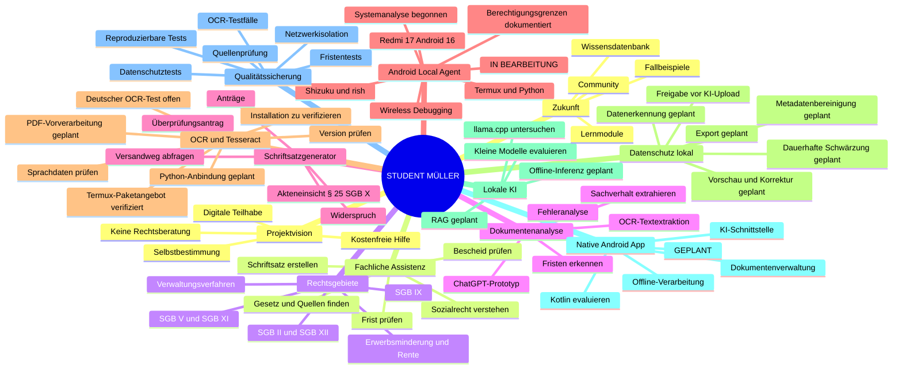

# Student Müller – Projekt-Mindmap V1.3

**Stand: 04.11.2026**

## Legende

- **Vorhanden / Grundlagen:** konzipiert oder als Prototyp bearbeitet.
- **In Bearbeitung:** technische Arbeit wurde begonnen, ist aber noch nicht vollständig.
- **Zu verifizieren:** technische Möglichkeit oder Vorarbeit ist bekannt, der konkrete Geräte- oder Laufzeittest ist noch nicht belegt.
- **Geplant:** noch nicht implementiert.

## Fortschrittsübersicht

| Arbeitspaket | Status |
|---|---|
| 1 – Fachliche Intelligenz | Grundlagen vorhanden; Prototyp in Weiterentwicklung |
| 2 – Android Local Agent / Datenschutz | In Bearbeitung |
| OCR / Tesseract | Technische Evaluierung; Installation und OCR-Lauftest zu verifizieren |
| 3 – Native Android-App | Geplant |
| 4 – Wissens- und Funktionsausbau | Geplant |

## Technische Vorarbeiten auf dem Android-Gerät

Bereits dokumentiert sind Termux, Python, Wireless Debugging, Shizuku und `rish`. Android-Paket- und Systeminformationen sowie Berechtigungsgrenzen wurden unmittelbar am Gerät untersucht. Das ist geräte- und systemnahes Prototyping, aber kein Nachweis für Root-Zugriff oder direkte Treiber-/Registerprogrammierung.

Tesseract ist im offiziellen Termux-Paketrepository vorhanden. Die lokale Installation, Sprachdaten (insbesondere Deutsch) und ein reproduzierbarer OCR-Lauftest müssen noch durch konkrete Terminalausgaben belegt werden.

**Wichtig:** OCR, sichere Schwärzung, Metadatenbereinigung und Dokumentenexport gelten nicht als fertige App-Funktionen.
