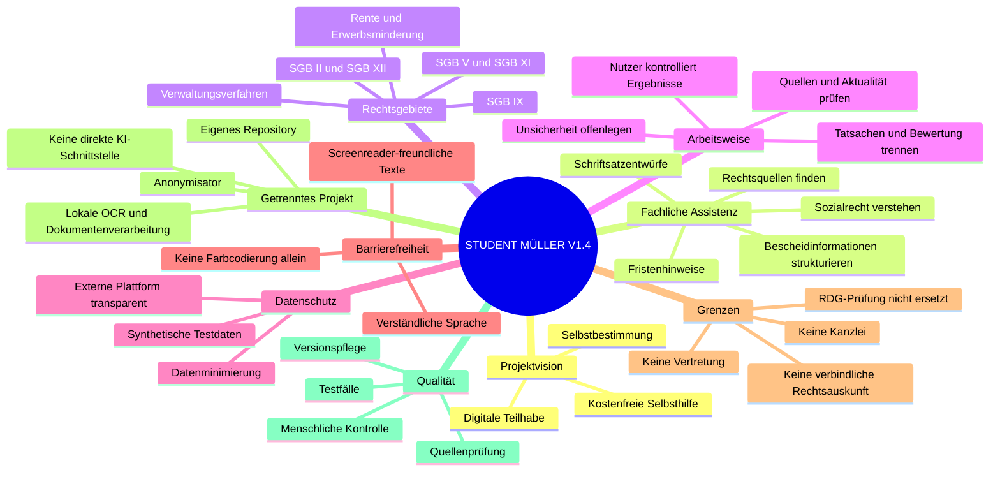

# Student Müller – Projekt-Mindmap V1.4

**Stand: 04.11.2026**

Student Müller ist ein ChatGPT-basierter Informations- und Selbsthilfeassistent für die eigenständige Bearbeitung der eigenen Angelegenheiten. Die Android-Anwendung zur lokalen Dokumentenverarbeitung ist ein separates Projekt: [Anonymisator](https://github.com/samysmurf/Anonymisator).

## Legende
- **Vorhanden / Grundlage:** dokumentierter Prototyp oder durchgeführte Arbeit.
- **In Bearbeitung:** begonnen, aber nicht abgeschlossen.
- **Geplant:** noch nicht implementiert.
- **Zu prüfen:** rechtliche, fachliche oder technische Bewertung offen.

## Status
| Bereich | Status |
|---|---|
| ChatGPT-basierter fachlicher Prototyp | Grundlagen vorhanden; Weiterentwicklung |
| Quellen- und Dokumentenworkflow | konzipiert; Qualität je Funktion prüfen |
| Schriftsatzentwürfe | Arbeitsworkflow; Nutzerprüfung erforderlich |
| Native lokale Dokumentenverarbeitung | Nicht Bestandteil dieses Projekts |
| Barrierefreiheit | Entwicklungsziel; keine Konformitätsprüfung |

## Projektgrenze
Anonymisator ist ein eigenständiges Android-Projekt. Es soll Dokumente lokal verarbeiten und besitzt keine direkte KI-Schnittstelle. Student Müller ist davon technisch unabhängig.
